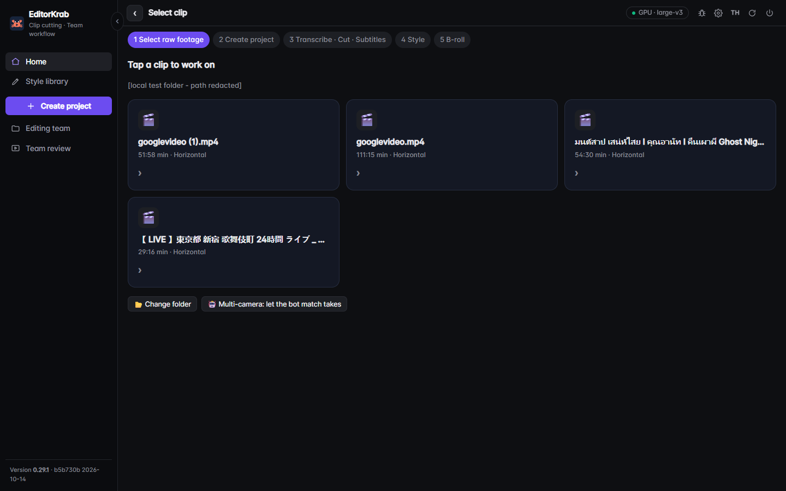
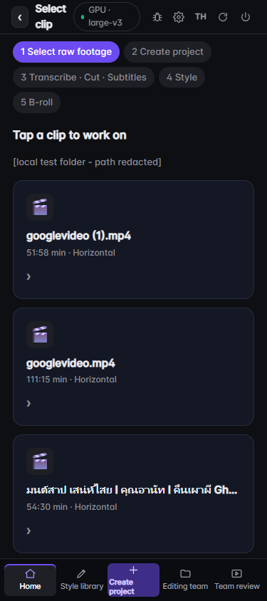

# Desktop media, motion and review findings — 14 October 2026

Task: `3b02accd-c2fe-46e0-af71-78fa52c992e0`. Baseline: `b5b730bb064277aa8dd288a842716db5bf24d3ba` (version label 0.29.1). This branch adds changes; it is not a released update or a production certification.

## What changed

- Both CLI story planning and the app story-planning worker now use the same whole-file transcription helper. Sources over 15 minutes save approximately 10-minute pieces, at a nearby quiet span, and resume after the last completed piece. A failed current piece is retried.
- New cache/checkpoint identity includes the content SHA256, resolved model/device/compute, model directory, language, batching and checkpoint schema. Legacy transcripts remain readable without claiming their source identity was verified. Preserve old work; regenerate explicitly when identity matters.
- Final output and checkpoint writes are atomic. A completed checkpoint survives a failed final write; incomplete metadata cannot masquerade as a legacy transcript.
- A compact `.lines.json` supports the agent instructions. Story-selection instructions ask for at most ten distinct stories on long sources. This is a prompt rule, not proof that AI chose the best ten or a new ranking engine.
- The shared recognizer bounds phrase and word timestamps to the audio duration, retaining Thai word pieces. This fixes a real final phrase that ended 0.668 seconds beyond source-3. Zero-duration pieces can remain: valid bounds do not establish alignment quality.
- Long filenames now stay inside cards even when shared CSS changes the tiles to a column. The grid also shrinks on small screens; the full name remains in the tooltip and selection screen.

## Machine and procedure

Windows, Python 3.12.10, RTX 3070 Ti Laptop GPU 8 GiB. Existing configured large-v3, CUDA/int8_float16, batched 15-second recognition windows, automatic language. No source video or full transcript is included in this public evidence directory.

Four supplied MP4 sources were inventoried with content SHA256 and ffprobe metadata. Originals stayed in the supplied folder; isolated copies were made under the configured workspace. All four decoded completely with FFmpeg, exit 0 and no error lines. See [source inventory](desktop-20261014/sources.json) and [decode results](desktop-20261014/decode-results.json).

Recognition trials called EditorKrab `scripts/run_clip.py <isolated-source> --max 60 --trial-id <id>` sequentially. The supervisor used `perf_counter` around each process and sampled process-tree RSS once per second. Time includes CLI startup, hashing, automatic language detection, transcription and writing; it excludes copying the source and the later AI selection/edit/export stages. These are single attempts, with warm installed dependencies, concurrent host activity and no controlled hardware-isolation claim.

| Source | Input duration | CLI elapsed | Outcome | Initial phrases |
|---|---:|---:|---|---:|
| source-1 | 51m 57.77s | 43.494s | Rejected automatic language: best guess `nn`, confidence 0.30; no forced language | 0 |
| source-2 | 111m 15.18s | 354.449s | Full transcription; expected exit 2 / WAIT for agent stories | 2,242 |
| source-3 | 54m 30.25s | 262.753s | Full transcription; expected exit 2 / WAIT; one phrase beyond end discovered | 1,214 |
| source-4 | 29m 15.50s | 522.214s | Operator interrupted the isolated CLI worker during a simultaneous live UI recognition job | 0 final |

[Raw results](desktop-20261014/asr-results.json) retain every attempt, including failures and interruption. Source-2 peak sampled process-tree RSS was 3,549,917,184 bytes; source-3 was 3,970,478,080 bytes. Source-4 is not a normal speed benchmark: GPU memory reached 7,840/8,192 MiB with CLI and app recognition active. Only the verified child CLI PID was terminated, leaving the authenticated UI worker running. See [interruption record](desktop-20261014/source-4-interruption.json). Its timing log lacks normal completion and must not be used as a successful trial.

Full-file results were produced while the patch was being developed, before final model-identity and timestamp-bound refinements. They are measurements of that trial candidate, not a fresh four-file run of the final diff. Applying the final bounds helper to preserved real output reduced invalid phrase bounds from 1 to 0 on source-3; it is not a new recognition run. A fresh final-code recognition of its last 10.251973 seconds also produced zero invalid phrase/word bounds. See [bounds replay](desktop-20261014/bounds-regression.json) and [fresh tail check](desktop-20261014/tail-regression.json).

## Motion through the real app

The user signed in through Google in a headed Playwright browser. The motion page selected each existing template, filled Thai text and used its actual MOV button. There was no replacement renderer or authentication bypass. All three exports succeeded:

| Template | Duration | Frame | Codec / pixel format | Bytes |
|---|---:|---|---|---:|
| hook-title | 3.0s | 1080×1920 | ProRes / yuva444p12le | 44,235,344 |
| stat-number | 3.0s | 1080×1920 | ProRes / yuva444p12le | 30,908,297 |
| sentence-pair | 2.2s | 1080×1920 | ProRes / yuva444p12le | 20,530,728 |

[Metadata, checksums and sampled alpha](desktop-20261014/motion-results.json) show transparent and opaque pixels at three times per MOV. Sampled frames were visually inspected; Thai text is visible and stays in frame. These samples do not inspect every frame, every text length, or prove CapCut import compatibility. The page's advertised 20–40 seconds is an estimate; exact render-duration measurements were not successfully captured, so no measured render-speed claim is made.


## Real MP4 pilot: technical pass, editorial fail

A separate 30-second source-3 draft was created and exported with EditorKrab's existing `video_editor.capcut` and `draft_export` functions in a fresh Python process. Browser interaction was no longer available at this stage. This is API-function integration evidence, not a complete button-by-button UI or CapCut application test. An overlays sidecar placed the MOV produced by the real motion UI at 3 seconds; the overlay-creation API was not exercised for this pilot.

Create plus export took 5.643 seconds on this machine with prepared subtitles and an existing MOV. This excludes full-file recognition, story selection, motion generation and human review, and cannot be compared to manual editing time. The MP4 is 30 seconds, H.264 1920×1080/25fps with AAC; complete decode exited 0 with no errors. [Output metadata and hash](desktop-20261014/pilot-media-check.json).

Five frames at 1, 3.5, 5.5, 15 and 29 seconds were inspected. Motion overlays play, but the arbitrary test motion overlaps an unrelated subtitle and the low-resolution source already contains large text. The pilot therefore **fails editorial acceptance**. It is an integration fixture, not a finished story, and has not passed listening/QC or human approval. Its source frames and full video remain private. No batch was produced.

## UI overflow verification

Playwright checked actual supplied filenames at 1440×900 and 375×844. At 375px, document scroll width was 375px and each tile's client/scroll width was 337px. At desktop, each tile's client/scroll width matched; long title text was ellipsized inside its content box. PNG dimensions were verified independently. Only the displayed folder path was redacted in the public captures, after layout loaded.




The added-line raw-colour diff check produced no matches. An independent reviewer found two cache issues (final metadata failure and actual CPU fallback model identity); both were corrected with regression tests. The reviewer reran the checkpoint suite successfully and found no remaining serious regression. This focused review does not certify the entire interface or accessibility.

## Reproduce software checks

```powershell
python scripts/long_transcription_test.py
python scripts/benchmark_test.py
python scripts/motion_cut_test.py
python scripts/capcut_font_test.py
python scripts/smoke_test.py
git diff --check
```

Checkpoint suite: 7 tests passed, including interrupted piece retry, content/model invalidation, legacy compatibility, failed final transcript/metadata writes, quiet boundaries on real generated audio, CPU/GPU model resolution and Thai timestamp bounds. Benchmark suite: 14 passed. Motion-cut and font tests passed. Final smoke suite passed. Logs: [checkpoints](desktop-20261014/checkpoint-final.txt), [benchmark](desktop-20261014/benchmark-final.txt), [smoke](desktop-20261014/smoke-final.txt). These checks use fixtures/mocks where appropriate; only the explicitly listed real trials used the supplied video.

## Assessment of the attached reviews and next work

The newer review is broadly fair: this is a working local editing workflow with external agent decisions, not evidence of autonomous production readiness. It correctly separates code presence from acceptance. Refine these statements before publication:

- Resume between finished pipeline stages is distinct from saving partial recognition. This branch addresses partial recognition; it does not add resumable full-video rendering.
- Whisper recognition already uses short windows. The long-video weakness was durability and whole-file audio/model handling, not a single 60-minute decoder window. Automatic language detection still extracts/decodes full audio and can be uncertain on ambient/non-speech sources.
- External data paths are real, not merely speculative: `config.example.json` enables automatic reports; `kit_settings._hub_report` sends text/page/version/errors to configured Supabase; `drive.share_file` explicitly grants `anyone` reader access after an invoked upload. This is source inspection, not a completed network/privacy audit. Web-AI packets contain transcript text. Local video processing does not mean every feature is offline/private.
- Existing tests, proxies, timelines and backups should be extended rather than replaced solely because modules are long. File length alone does not establish an architectural failure.

### Browser AI is a supported primary workflow

The product goal explicitly includes people using an AI in a browser without installing a local coding agent. Existing `web_ai_json` and the editor's Web-AI export/import controls provide that path: export prompt plus timed text, ask the chosen web AI, paste its JSON back, validate it locally, then continue rendering with local media. Optional local-agent answer files share the same schema; they are not a prerequisite.

This patch puts browser instructions first in exported packets and includes a ready Web-AI packet and import command whenever CLI story/emphasis work waits. One downloaded Markdown file contains the instructions, timed transcript, expected JSON format and available motion choices for the relevant step; no additional typed prompt is required by this workflow. The download no longer overwrites the clipboard with a local-agent command. The old agent command remains available in CLI output for compatibility.

The packet generated from the real Thai source includes compact lines without word timestamps; [contract evidence](desktop-20261014/web-ai-proof.json). Playwright captured an actual successful download (`input.mp4.web-ai-stories.md`) and pasted a clearly labeled JSON test fixture back into the real UI; one imported story appeared. The live backend was the already-running baseline process, so final packet wording was checked separately in a fresh Python process. Existing smoke checks exercise pasted JSON import, wrong-file rejection and preservation of spoken text. A real ChatGPT/Claude web answer has not been obtained during this trial, and no direct connector/MCP access from a web provider is claimed.

Review wording such as “must depend on Claude Code/Codex” is therefore misleading. The user still makes editorial decisions with their chosen AI, but can use the browser path. “Fully automatic” is a separate capability and should not replace provider independence as the acceptance goal.

Next priorities: finish one human-watched short with intelligible speech and corrected names, prevent competing ASR work from exhausting GPU memory, evaluate story selection with a reference set, inspect actual chunk seams by listening, and exercise CapCut open/edit/save/reopen/export on supported versions. Team authorization and two-machine sync still require service acceptance. Full-length editing, resumable render queue and measured manual-versus-assisted saving remain separate work; this patch does not claim to deliver those systems.

WER/CER, manual editing time saved, clean installation of this branch, hosted CI for this change, cross-version CapCut, Mac hardware acceptance, complete speech listening and production deployment remain unverified.
