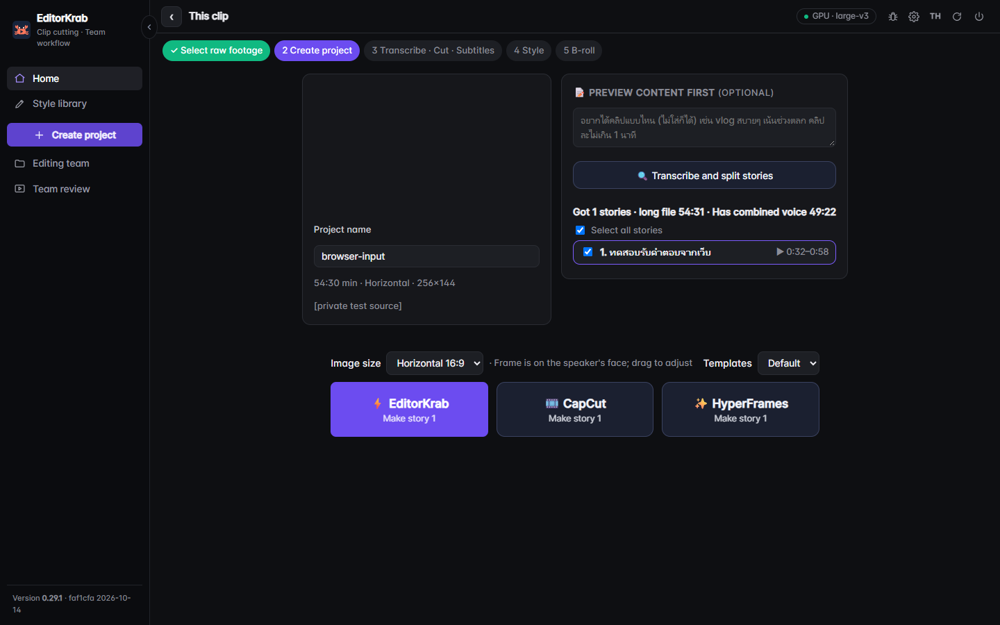
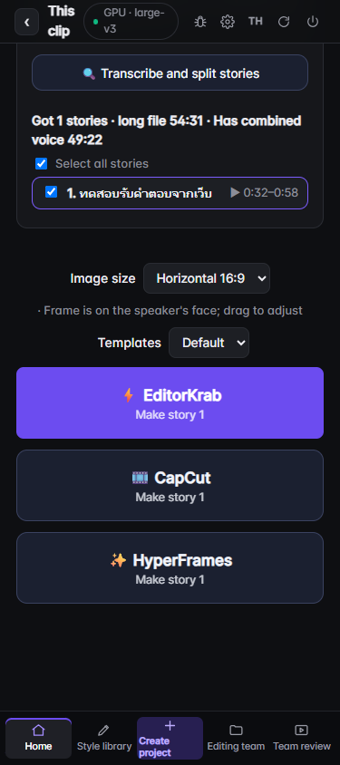

# Manual reports and restricted Drive uploads — 14 October 2026

Task `5deb0144-a4b4-4e9c-bb49-d0d0cbcb55f2`. Supabase continues to provide member identity, organization roles and team project/review metadata. No member rows, migrations or existing team records were removed. Video processing remains local unless the user chooses an external feature.

## Reporting

The report icon now links directly to GitHub's new-issue page. It attaches no current path, logs, transcript or diagnostics. The user reviews and submits there; public repository issues remain public. A private security concern belongs in the existing [security process](../../SECURITY.md), not an automatically populated public issue.

The app no longer collects and uploads frontend errors or reports server crashes to Supabase. The legacy report endpoint skips automatic requests even if an old config enables them; manual calls only return a draft link containing the description the caller supplied. It does not send or persist a report. Legacy `cutlog` Google Sheet/webhook transmission is disabled, including old `report_url` settings; local run/feedback logs remain available. Existing report files and remote rows were not deleted.

On this test machine, private config was backed up locally and `auto_bug_report=false`, `report_url=off` were written and read back. This also disables the old report paths in the existing process until its next ordinary restart. The server was not restarted or deployed; the new backend behavior was tested in isolation. No private config or backup is committed.

## Drive

Uploads no longer create `anyone` reader permissions. The app checks the destination folder and resulting file's permission lists, and rechecks cached files. Broad (`anyone`/`domain`), unknown, empty or incomplete permission results fail closed. Content SHA256 replaces the old name/size cache identity so different same-size content is not confused with an old upload.

Only a chosen user's or group's existing access is retained. The owner adds reviewers in Drive; EditorKrab team membership is not a Google Drive permission grant. Old public links are not revoked, and manually pasted links are not audited by this upload path. Legacy name/size cache entries are not reused as validated restricted uploads. Uploading again may create a new private copy; old files remain.

Google documents direct and inherited permissions and the `user`, `group`, `domain` and `anyone` access types in [Manage sharing](https://developers.google.com/workspace/drive/api/guides/manage-sharing). The guard checks the state returned by Drive at that moment; another user can change permissions later. This is not a continuous sharing monitor.

## Verification

- `python scripts/report_privacy_test.py`: passed. Legacy auto config cannot initiate a network request or report file; manual URL excludes supplied page/error diagnostics; legacy cut logs do not upload.
- `python scripts/drive_test.py`: passed with mocked Google APIs and real local OAuth callback. Covers PKCE, forged-state rejection, refresh, restricted uploads, no permission creation, permission recheck, rejected public/domain/incomplete lists, same-size content change and disconnect.
- `python scripts/login_gate_test.py`, `node scripts/team_entry_test.js`: passed. Member login and team entry remain covered.
- Final `scripts/smoke_test.py`: passed. JavaScript syntax checks passed for shell/ui/team scripts; raw-colour added-line check had no matches.
- Independent review found no serious regression. No live Google Drive upload, actual reviewer grant, permission revocation or schema change was performed.

Playwright used the authenticated real local app. A fresh browser-flow copy reused the real earlier transcript without rerunning recognition. The file-download button saved a 160,959-byte Markdown packet containing instructions, output JSON schema and 1,214 compact transcript lines. Invalid pasted text was rejected; a labeled fixture JSON imported one story. This proves the download/import path; it is not a real response from an external AI provider. [Browser proof](privacy-20261014/browser-flow.json).

On a cached first reload, Playwright caught old shared scripts still loaded; all HTML script references were then versioned forward. A fresh page showed the GitHub link, and a controlled frontend error generated **zero** report requests. Clicking opened GitHub's login/new-issue flow without submitting anything. [UI proof](privacy-20261014/privacy-ui.json).

The additional acceptance pass also found a 497px-wide action group at a 375px viewport. Stacking the three actions below 600px reduced document scroll width to exactly 375px; desktop remained 1440px. Screenshots retain layout but hide the private source video and path.

The change still requires a normal app restart/release for new backend code to replace the existing process. Provider AI output quality, live Drive acceptance and complete human editorial approval remain unverified. Supabase team metadata is retained; this is not a claim that the app is fully offline or stores only email addresses.
